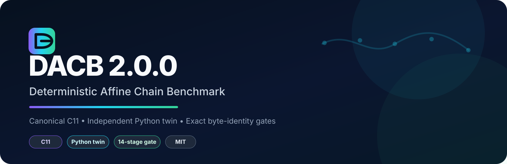
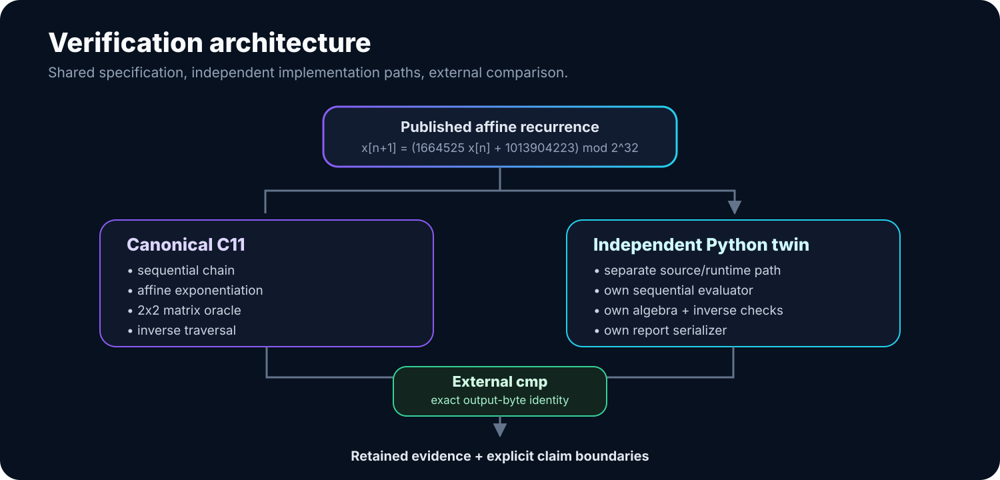
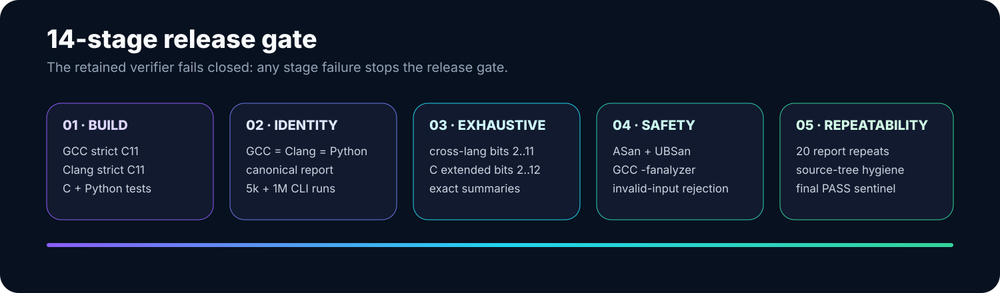

<p align="center">
  
</p>

<p align="center">
  <strong>Portable C11 canonical implementation · independent Python digital twin · exact deterministic verification</strong>
</p>

<p align="center">
  
  
  
  
</p>

# DACB 2.0.0

**DACB - Deterministic Affine Chain Benchmark** is a compact verification framework for long deterministic dependency chains. The canonical implementation is portable **ISO C11**. A separately written **Python digital twin** implements the same published mathematics without calling, importing, parsing, or sharing runtime state with the C implementation.

The core question is intentionally narrow:

> Can an implementation preserve the program, execute the complete dependency chain, respect exact arithmetic bounds, agree with independent mathematical oracles, detect semantic drift, and reject a confidently repeated wrong answer?

DACB does not score prose quality and does not treat agreement between two answers as proof. Correctness is established by independent computation.

## At a glance

| Boundary | DACB 2.0.0 |
|---|---|
| Canonical runtime | Portable C11 |
| Independent twin | Python 3.10+ |
| Canonical recurrence | 32-bit affine recurrence modulo `2^32` |
| State checks | Sequential, affine exponentiation, 2x2 matrix, inverse traversal |
| Cross-language contract | Exact output-byte identity |
| Long-chain gate | 1,000,000 dependent transitions |
| Deep reduced-domain gate | 5,596,492 seed/step cases through bits `2..11` |
| Extended C reduced-domain gate | 22,377,804 seed/step cases through bits `2..12` |
| Release verifier | 14 stages |
| License | MIT |

<p align="center">
  
</p>

## Why two implementations?

The C11 and Python implementations share the **published specification**, not implementation state. The Python twin does not invoke the C executable, import a C extension, read C-generated vectors, or consume C report output as its source of truth.

Each path independently generates deterministic output. The release gate compares those bytes externally with `cmp`. A formatting difference, line-order change, status change or numeric difference therefore fails the identity gate.

## Canonical recurrence

```text
x[n+1] = (1664525*x[n] + 1013904223) mod 2^32
x[0]   = 1
```

Canonical 5,000-step vector:

```text
last          = 4125282121
sum_mod       = 585303980
weighted_mod  = 554861868
```

The sequential, affine-transform and matrix checks agree on the final state, while the reverse traversal must recover the original seed.

## Verification model

<p align="center">
  
</p>

The retained release verifier covers:

1. strict GCC and Clang C11 builds;
2. C tests under both compilers plus independent Python-twin tests;
3. exact report identity across GCC, Clang and Python;
4. 5,000-step and 1,000,000-step cross-implementation identity;
5. bounded exhaustive cross-language verification through `2^11` and extended C verification through `2^12`;
6. ASan/UBSan, GCC `-fanalyzer`, invalid-input rejection, 20-run report repeatability and source-tree hygiene.

The included sealed transcript ends in `DACB_RELEASE_VERIFICATION_PASS`. See [`evidence/RELEASE_VERIFICATION.txt`](evidence/RELEASE_VERIFICATION.txt) and [`docs/RESULTS.md`](docs/RESULTS.md).

## Quick start

Requirements: an ISO C11 compiler, Python 3.10+ for the independent twin, `make`, and POSIX shell utilities for the full verifier.

```sh
git clone <your-repository-url>
cd DACB_2_0_0_C11
make
./build/dacb report
```

Run the ordinary unit/twin gate:

```sh
make test
```

Require exact C/Python report identity:

```sh
make cross
```

Run the full retained release campaign:

```sh
bash scripts/verify_release.sh
```

Verify the complete GitHub-ready repository manifest:

```sh
sha256sum -c MANIFEST.sha256
```

## CLI

```text
dacb report
dacb run STEPS
dacb exhaustive [MIN_BITS MAX_BITS]
dacb lattice preserve
dacb lattice plus
```

Numeric CLI arguments use unsigned ASCII decimal digits only (no sign or
whitespace). Both implementations reject malformed or out-of-range inputs
before computation. Exhaustive bounds must satisfy `2 <= MIN_BITS <= MAX_BITS <= 16`.
`make test` includes cross-language CLI rejection and valid-output parity checks.

`lattice plus` intentionally evaluates the mutated tie-to-`+1` rule so the semantic regression can prove that it differs from the preserved rule.

## Verification axes

DACB tests different failure directions rather than relying on one large run:

- **Depth:** exact chains through 1,000,000 dependent transitions.
- **State space:** complete reduced power-of-two periods through the documented finite bounds.
- **Oracles:** sequential iteration, affine-transform exponentiation, homogeneous 2x2 matrix exponentiation and inverse traversal.
- **Implementations:** GCC C11, Clang C11 and the independent Python digital twin.
- **Byte identity:** canonical reports and selected CLI results must match byte-for-byte.
- **Numeric semantics:** unsigned wrap behavior, checksum bounds, inverse arithmetic, exact finite dyadic duplicate forms and boundary seeds.
- **Mutation detection:** deliberately wrong multiplier, increment, weighting, wrap behavior, tie semantics, metric definitions and checksum behavior must be detected.
- **Recovery:** incorrect numeric candidates can be corrected only from independent internal oracles; stale or semantically different workloads are refused.

## Bounded exhaustive campaigns

| Gate | Domain | Cases | FNV64 | modsum |
|---|---:|---:|---|---:|
| Canonical report | bits `2..10` | 1,400,140 | `9f80ade0ca124045` | 220519645 |
| Deep C/Python gate | bits `2..11` | 5,596,492 | `bb145fc9fd64af85` | 701664029 |
| Extended C gate | bits `2..12` | 22,377,804 | `d6fcc0f67a842585` | 341034241 |

For the production `2^32` recurrence, DACB uses exact algebraic oracles and the documented full-period conditions for a power-of-two modulus. It does **not** claim exhaustive enumeration of all `2^32` seeds across a complete period.

## Semantic-drift regression

The non-core lattice module preserves a specific N=64 tie rule and deliberately tests semantic mutations. It covers impossible modulo outputs, candidate disagreement, repeated wrong consensus, stale workload/source retrieval, tie-rule mutation, energy-definition drift, checksum-scope defects and claims of verification without independent oracles.

This lattice fixture is a **semantic-drift regression**, not part of the affine benchmark's mathematical core and not a physical phase-transition claim.

## Repository layout

```text
canonical_c11/     canonical C11 library + CLI
python_twin/       independent Python digital twin
tests/             C tests, twin tests and adversarial fixtures
scripts/           release verifier + optional timing utility
docs/              math, architecture, verification and boundaries
evidence/          retained release verification records
assets/            GitHub header + architecture/verification graphics
presentation/      editable technical overview deck + PDF
provenance/        exact origin README/manifest + origin archive digest
.github/           CI, issue form and pull-request template
```

Documentation index: [`docs/README.md`](docs/README.md).

## Evidence and provenance

The canonical report digest retained by the release is:

```text
1d2ffc1bd5703d8514a62226e42bc007798f454c9c935d974071d6add57d7679
```

This GitHub presentation pass is based on the preserved standalone DACB 2.0.0 release, not a reconstructed implementation. The origin archive digest and the exact original README/manifest are retained under [`provenance/`](provenance/ORIGIN.md).

## Claim boundaries

When the included release verification passes, DACB supports the specific claims documented in [`docs/CLAIM_BOUNDARIES.md`](docs/CLAIM_BOUNDARIES.md). In particular, it does **not** claim cryptographic security, randomness quality, deterministic wall-clock timing, exhaustive enumeration of the full `2^32 × 2^32` seed/step space, or physical significance for the lattice regression.

## Security

DACB is offline and does not require network access, credentials, elevated privileges or external services. Security-relevant release checks include fixed-width unsigned arithmetic, invalid-input rejection, sanitizers, GCC static analysis and source-tree hygiene. The recurrence is not intended for cryptographic use.

## License

MIT. See [`LICENSE`](LICENSE).
